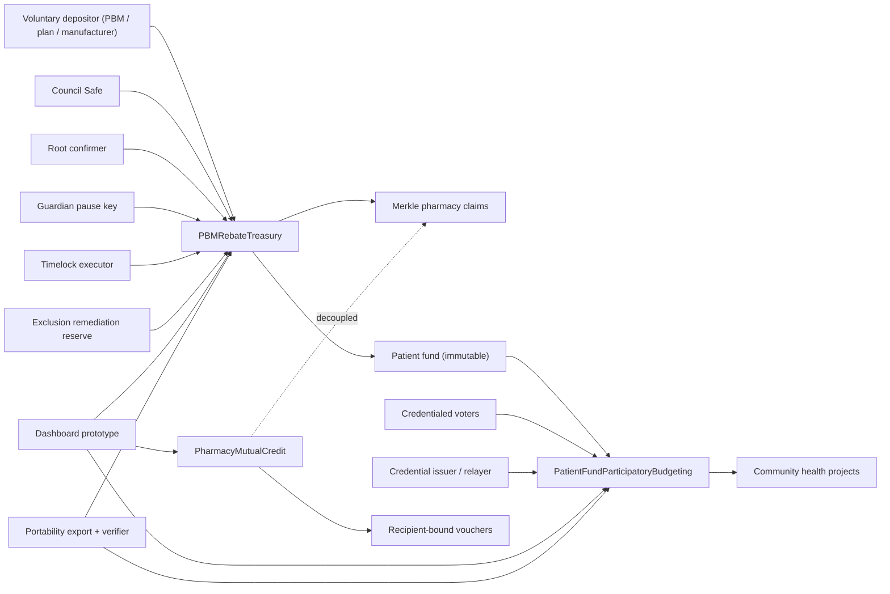

# Pharmacy Fiduciary Commons

<div align="center">

**Anti-extractive fiduciary commons prototype reclaiming captured pharmaceutical rebate surplus for independent community pharmacies and patient-governed funds.**


</div>

> [!CAUTION]
> **NOT AUDITED - DO NOT USE REAL FUNDS YET**
>
> This repository is a working local/testnet prototype. Do not deploy, deposit, or route real capital to this treasury on mainnet until an independent security audit has been completed and published.

---

## Public Boundary

| Question | Current answer |
|----------|----------------|
| What is this? | Local/testnet smart-contract prototype for voluntary pharmacy rebate pass-through deposits, Merkle claim proofs, dispute accounting, and patient-fund allocation. |
| Who deposits & what does an absence prove? | Off-chain rebates originate from drug manufacturers and are negotiated by PBMs/plan intermediaries; on-chain `depositRebate()` is voluntary for any non-sanctioned depositor (PBM, plan sponsor, pass-through administrator, or manufacturer). A missing on-chain deposit proves **only** that zero tokens reached this contract—not that money was owed—unless paired with an independent expected-deposit record ([VOLUNTARY_DEPOSIT_AND_OMISSION_THREAT_MODEL.md](docs/design/VOLUNTARY_DEPOSIT_AND_OMISSION_THREAT_MODEL.md)). |
| What can be verified today? | Solidity tests, Merkle fixtures, export self-consistency checks, static dashboard build checks, and repository verification scripts. |
| What is synthetic? | Public dashboard PBM names, displayed amounts, onboarding fixtures, and sample receipt payloads. |
| Privacy posture | Synthetic data only, zero visitor tracking in the static dashboard, and no production privacy guarantee; see [PRIVACY.md](PRIVACY.md). |
| Is it audited? | No. Independent security audit remains a launch blocker. |
| Is it deployed? | No mainnet deployment is represented by this repository. |
| Who should review first? | Solidity/security reviewers, privacy and retaliation-risk reviewers, documentation editors, and dashboard accessibility reviewers. |

---

## Credibility Posture

This project should be read as a prototype fiduciary commons with tests, receipts, privacy caveats, and explicit launch blockers. The public claim is not that the agent system is powerful; the public claim is that every status statement should be traceable to code, tests, generated receipts, or a clearly marked unresolved risk.

Public-facing language should preserve these boundaries:

- local formal checks and Council Engine outputs are off-chain verifier evidence, not an audit replacement;
- only the Router (`Dizzy-the-Polymath`) speaks to humans on chat, GitHub, or the operator inbox—verifier workers (`CouncilEngine`, scripts, backend) and progress watchdogs report typed receipts upward, never message users directly, and hold zero live execution or fund-movement authority ([AGENT_ROUTER_WORKER_WATCHDOG_CONTRACT.md](docs/design/AGENT_ROUTER_WORKER_WATCHDOG_CONTRACT.md));
- ZK/nullifier work is semantic mock and design-spec evidence unless explicitly marked production-ready;
- dashboard panels distinguish synthetic fixtures from contract-backed or locally checked evidence;
- launch, mainnet, real-funds, and public-wallet readiness remain blocked until the production checklist and independent audit requirements are satisfied.

---

## What This Cannot Do (Adversarial Limitations & Disclaimers)

> [!WARNING]
> **This system is a smart contract prototype for rebate accounting and custody. It does NOT solve physical supply chain problems:**
> * **No Physical Medicine or Inventory Guarantees:** This protocol records accounting entries and custody movements. It does not track, verify, or guarantee physical inventory, drug availability, delivery, pharmacy stock, clinical outcomes, or patient access. On-chain actions do not guarantee physical medicine supply or pharmacy fulfillment.
> * **Mutual Credit Vouchers = Ledger Reservations Only:** Mutual credit vouchers create ledger capacity reservations only - they do not represent or guarantee physical medicine on-chain, and they do not bypass local supply shortages or distributor caps.
> * **Mutual Credit Clearing != Guaranteed Supply:** The mutual credit clearing mechanism operates as a liquid accounting framework for settlements and liquidity support between pharmacies. It does not guarantee physical supply, logistics, or distribution capacity.
> * **Scarcity Triage = Proposed Only:** Scarcity-based triage policies and design proposals are theoretical frameworks. They are not executed autonomously on-chain or enforced by smart contracts.
> * **Centralized Governance Control:** The `COUNCIL_ROLE` retains significant administrative control. Autonomy is restricted to off-chain governance and multi-sig operations; there is no autonomous on-chain local federation execution.
> * **Privacy and Linkage Risks:** Legacy registration still uses stable credential hashes on-chain, creating a persistent identification vector that could be used for profiling or blacklisting. A mock ZK/nullifier registration slice now exists for semantic testing in `PatientFundParticipatoryBudgeting`, but it is not production privacy: `msg.sender`, public voting events, transaction gas source, timing, and RPC metadata remain linkable. The production zk-nullifier design in [IDENTITY_NULLIFIER_DESIGN.md](docs/design/IDENTITY_NULLIFIER_DESIGN.md) remains a design specification only.
> * **Participatory Budgeting Solvency Debt (Liveness & Trust Risk):** The contract no longer hard-reverts when round start/finalization finds the patient-fund balance below outstanding obligations. It records the shortfall as `totalDebt`/`roundDeficit` and lets the round lifecycle continue, but actual project claims still require real token liquidity. These names are prototype accounting labels for observed shortfall changes, not a creditor ledger, repayment schedule, funding proof, or guarantee that claimants can be paid.
> * **No Professional Advice:** All outputs, files, and dashboards are for local prototype demonstration only. None of the contents constitute legal, financial, or medical advice.
>
> For deeper documentation on trust roots, voluntary deposits, scarcity, and threat boundaries, see [TRUST_ASSUMPTIONS.md](docs/design/TRUST_ASSUMPTIONS.md), [VOLUNTARY_DEPOSIT_AND_OMISSION_THREAT_MODEL.md](docs/design/VOLUNTARY_DEPOSIT_AND_OMISSION_THREAT_MODEL.md), [SCARCITY_GOVERNANCE.md](docs/design/SCARCITY_GOVERNANCE.md), [CARE_CONTINUITY.md](docs/design/CARE_CONTINUITY.md), and [RETALIATION_AND_PRIVACY_THREAT_MODEL.md](docs/design/RETALIATION_AND_PRIVACY_THREAT_MODEL.md).

---

## Status Summary

The current checkpoint is a prototype with tested treasury, voting, mutual-credit, portability, and dashboard surfaces, but it is not audited, not mainnet deployed, and not public-wallet ready. Trust assumptions and custody roles are consolidated in [TRUST_ASSUMPTIONS.md](docs/design/TRUST_ASSUMPTIONS.md); runtime behavior and policy boundaries are tracked in [MECHANISM_COVERAGE.md](docs/ops/MECHANISM_COVERAGE.md); care-continuity and participant-safety boundaries are documented in [CARE_CONTINUITY.md](docs/design/CARE_CONTINUITY.md), [RETALIATION_AND_PRIVACY_THREAT_MODEL.md](docs/design/RETALIATION_AND_PRIVACY_THREAT_MODEL.md), and [SCARCITY_GOVERNANCE.md](docs/design/SCARCITY_GOVERNANCE.md). Public launch remains blocked by [PRODUCTION_READINESS_CHECKLIST.md](docs/ops/PRODUCTION_READINESS_CHECKLIST.md).

---

## What Runs Today

| Surface | Status |
|---------|--------|
| `PBMRebateTreasury` | Working Solidity contract with epoch escrow, Merkle claims, dispute handling, sanctions, recall, pause, and cap controls |
| `PatientFundParticipatoryBudgeting` | Working patient-fund voting prototype with council registration and relayer-assisted voter self-registration |
| Mock ZK/nullifier registration | Semantic mock only: verifier/root/version-gated registration and nullifier reuse tests exist, but production unlinkability is not implemented |
| `PharmacyMutualCredit` | Working decoupled mutual-credit prototype with reserved-capacity, recipient-bound vouchers |
| Experimental governance/manifold drafts | Draft prototypes deployed only in focused tests for review; not integrated into treasury/PB/mutual-credit runtime and not production mechanisms |
| Tests | Compile and unit tests run in CI; run locally with `npm.cmd test` |
| Dashboard | Static prototype with local/test Web3 integration, synthetic-data labels, accessibility improvements, and offline verifier panel |
| Merkle tooling | Allocation root/proof generator |
| Portability export | Prototype JSON export plus offline self-consistency checks; RPC-backed verification is required for chain provenance |
| Continuity artifacts | Draft Node.js and static-browser tools for local paper-voucher and relay-intake review; not a live relay or on-chain settlement authority |
| Mainnet | Not deployed |
| External audit | Pending |

---

## Quickstart

Prereqs: Node.js 20 LTS or 22 LTS + npm.

Windows PowerShell note: if `npm` is blocked by script execution policy, use `npm.cmd` instead.

For a guided first run, start with [ONBOARDING.md](ONBOARDING.md). It keeps the demo path short and labels which outputs are synthetic fixtures versus contract-backed checks.

For the current public roadmap and contributor focus areas, see [NEXT.md](NEXT.md).

```bash
npm.cmd ci
npm.cmd run compile
npm.cmd test
```

## Formal Verification Lane

This repository includes an off-chain Council Engine lane for local formal checks around fiduciary math and fraud-triage boundaries. Treat this as verifier evidence, not as a substitute for an external audit or production deployment review.

| Surface | What it checks | Boundary |
|---------|----------------|----------|
| `tools/council/pbm_fraud_formal_invariants.py` | MME hard-stop bounds, refill-too-soon timing, HHI concentration bounds, and Benford anomaly scoping | Local Python/Z3/schema proofs over project model logic only |
| `tools/council/formal_theorem_prover_engine.py` | Z3 rebate arithmetic helper plus generated Lean/Dafny-shaped scaffolds | Z3 evidence only where the solver is invoked; Lean/Dafny scaffolds are unverified unless checker execution is captured |
| `test/PBMFraudFormalInvariants.test.js` | Hardhat bridge into the Python formal-invariant suite | Local/CI evidence; not a mainnet safety certificate |

Generate Merkle roots and proofs:

```bash
npm.cmd run merkle:allocations -- --in allocations.json --out merkle.json
```

Run the portability export prototype:

```bash
node scripts/export-portability.js \
  --exporter <participant_address> \
  --from-block <deployment_block> \
  --to-block <end_block_or_latest>
```

Exports fail closed by default on RPC/query failures or missing Merkle allocation material. `--allow-partial` and `--allow-unbounded-query` are explicit prototype/debug overrides, not production defaults.

Verify a portability export:

```bash
npm.cmd run verify:export -- --file exports/<participant_address>.json
```

Offline verification requires proof material when claims are present, but it only checks untrusted export self-consistency and Merkle math. Use `--allow-incomplete` only when intentionally inspecting an incomplete export; add `--rpc <url>` for chain-provenance verification.

Draft continuity tooling is available at `tools/resilience/continuity-engine.mjs`,
`tools/offline/continuity-kit.html`, and `tools/resilience/proxy-validator.js`.
The Node engine requires a local `LOCAL_MAC_SECRET`, fails closed on missing or
invalid MACs, and produces review/intake artifacts only. The static browser kit
uses Web Crypto for local voucher MAC checks. The proxy validator checks relay
batch shape, duplicate nullifiers, and metadata leakage. None of these artifacts
is a live proxy relay, redemption path, settlement authority, or production ZK
proof generator.

---

## Fiduciary Dashboard Interface


*Figure 1: The Ledger of Omissions & Fiduciary Dashboard displaying synthetic PBM pass-through gap accounting, deposit status provenance (`PROVENANCE: LOCAL MOCK / SYNTHETIC`), and Web3 wallet integration.*

---

## Architecture



## Current Checkpoint

- Treasury remediation, root-backed claims, governance funds, and epoch escrow are separated in contract accounting.
- Voter registration supports EIP-712 relayer authorizations and direct trusted-issuer credential signatures.
- Patient-fund matching now uses pull-based project claims after round finalization.
- Mutual-credit vouchers reserve issuer capacity and can be redeemed only by the intended registered recipient.
- Dashboard values are explicitly synthetic unless contract-backed.
- Portability exports can be checked offline for structure/Merkle math and with RPC for chain provenance.

---

## What This Is

`PBMRebateTreasury` is an Ethereum smart contract prototype that:

- records **voluntary** rebate pass-through deposits on-chain (`depositRebate()`) from any non-sanctioned caller—whether a Pharmacy Benefit Manager (PBM) passing through manufacturer rebates, a self-insured plan sponsor, a transparent pass-through administrator, or a direct-rebating drug manufacturer—logging `msg.sender`, `amount`, `timestamp`, and an unauthenticated caller `source` memo;
- routes captured funds to independent pharmacies through Merkle-proof claims (`claim()`);
- allocates a configurable patient share of every gross claim (`10%` default, bounded `5%–30%`) to an `immutable` `patientFund` address at claim time;
- makes ledger absences inspectable **only** when paired with independently sourced expected-deposit records (an absent deposit alone does not prove an unpaid obligation; see [VOLUNTARY_DEPOSIT_AND_OMISSION_THREAT_MODEL.md](docs/design/VOLUNTARY_DEPOSIT_AND_OMISSION_THREAT_MODEL.md));
- separates treasury custody from adjacent prototypes such as mutual credit, vouchers, dashboard tooling, and participatory budgeting.

This is prototype infrastructure for transparent rebate pass-through. It is not legal, financial, medical, or investment advice.

---

## Core Lifecycle

1. Voluntary depositor (PBM, plan sponsor, pass-through administrator, or manufacturer) calls `depositRebate()`.
2. The council Safe calls `proposeRoot()` for the current epoch.
3. A separately configured root-confirmer Safe calls `confirmRoot()`.
4. Pharmacies claim with Merkle proofs through `claim()` (or contest via `flagClaim()` / `flagExclusion()`).
5. Council calls `finalizeEpoch()` to close the epoch.
6. After the 30-day `RECALL_DELAY`, unclaimed funds can be recalled exclusively to the `immutable` `patientFund`.

---

## Treasury Buckets

| Bucket | Allocation | Purpose |
|--------|------------|---------|
| Distribution pool | 99% default, adjustable if governance reserve changes | Pharmacy Merkle claims |
| Governance reserve | 1% default, executor-governed from 0-5% | Council operations through `EXECUTOR_ROLE` |

## Patient Fund (`immutable`)

| Source | Amount |
|--------|--------|
| Every gross claim | 10% default routed to `patientFund`; executor-governed from 5-30% |
| Unclaimed epoch funds after recall delay | 100% routed to `patientFund` |
| Stale unallocated pool recovery (after 180 days) | 100% routed to `patientFund` |
| Non-payout ERC-20 sweeps | 100% routed to `patientFund` |

`patientFund` is `immutable` after deployment—no admin, council, or timelock can redirect it. If `patientFund` is configured directly as the `PatientFundParticipatoryBudgeting` contract, payout-token inflows and direct payout-token surplus in that contract are treated as patient-bound matching liquidity for the next round and logged with `ExternalPatientFundsApplied`. They are not treated as council-refundable funds.

## Roles & Agent Control-Plane Boundary

| Role | Holder | Permissions |
|------|--------|-------------|
| `COUNCIL_ROLE` | 3/5 Gnosis Safe | Epoch management, root proposal, dispute resolution, recall, sanctions, unpause |
| `ROOT_CONFIRMER_ROLE` | Separate Safe or governance address | Independently confirms proposed Merkle roots and exclusion payout ceilings; rotation is timelocked |
| `EXECUTOR_ROLE` | TimelockController | Downward-only hard-cap reduction, epoch cap updates, BP bounds (`patientClaimBP`, `governanceBP`), governance reserve withdrawal, confirmer rotation |
| `GUARDIAN_ROLE` | Separate fast-response address | Emergency pause only; cannot unpause or access funds |

**Off-Chain Agent Voice Rule:** Across sibling tooling ([AGENT_ROUTER_WORKER_WATCHDOG_CONTRACT.md](docs/design/AGENT_ROUTER_WORKER_WATCHDOG_CONTRACT.md)), only the Router (`Dizzy-the-Polymath`) communicates with humans on chat, GitHub, or the operator inbox. Verifier workers (`CouncilEngine`, export/formal scripts, backend sagas) and progress watchdogs report structured receipts upward, **never** message users directly, and hold **zero** on-chain signing or custody authority.

---

## Security Properties & Cap Invariants

- **Permanent downward-only hard cap (`hardAbsoluteVolumeCap`)**: Initialized at `10 * _initialDailyCap` at deployment. `reduceHardCap(newCap)` (`EXECUTOR_ROLE`) enforces `CanOnlyReduce()`—**the hard cap can never increase after deploy.** Raising that ceiling requires deploying a new treasury contract.
- **Adjustable epoch cap (`dailyVolumeCap`)**: Caps cumulative epoch-wide claim volume; `updateDailyCap(newCap)` (`EXECUTOR_ROLE`) can increase or decrease within `[minimumEpochVolume, hardAbsoluteVolumeCap]` (see [TRUST_ASSUMPTIONS.md](docs/design/TRUST_ASSUMPTIONS.md)).
- Root total and per-pharmacy `eligibleCap` enforced at root proposal and claim.
- Double-hash leaf construction for second-preimage protection.
- Root publication requires proposal by `COUNCIL_ROLE` and approval by a mutually exclusive `ROOT_CONFIRMER_ROLE`.
- `EXECUTOR_ROLE` and `ROOT_CONFIRMER_ROLE` administration is controlled by the timelock rather than council default administration.
- Recall only after `RECALL_DELAY`, only for unclaimed amount, sent to the `immutable` `patientFund`.
- Payout token cannot be swept; stray ERC-20 sweeps go exclusively to `patientFund`.
- `GUARDIAN_ROLE` is separate from `COUNCIL_ROLE`.
- `flagClaim` requires a valid Merkle proof and reserves disputed escrow against active caps.
- Root-exclusion payouts require independent `ROOT_CONFIRMER_ROLE` approval and draw solely from a separately funded remediation reserve.
- Sanctioned addresses cannot flag claims; open dispute flag blocks a parallel claim on the same epoch.
- Direct ETH transfers revert in `receive()` and `fallback()`; no proxy upgradeability.

---

## Merkle Leaf Encoding

```solidity
// Double-hash leaf. abi.encodePacked is safe here because all fields are fixed-size.
bytes32 leaf = keccak256(
    bytes.concat(keccak256(abi.encodePacked(pharmacy, grossAmount, eligibleCap)))
);
```

Each leaf encodes:

- `pharmacy`: claimant address
- `grossAmount`: gross allocation for this epoch
- `eligibleCap`: per-pharmacy maximum enforced on-chain

> Off-chain tooling must use `encodePacked`, not `encode`, when hashing leaves.

---

## Deployment & Post-Deploy Audit

Deployment uses `scripts/deploy-timelock-and-treasury.js` and post-deploy verification uses:

```bash
npm.cmd run audit:deployment -- --network <network>
```

Before any non-local deployment: complete an independent security audit, configure separate Gnosis Safes for `_council` and `_rootConfirmer`, deploy a `TimelockController` for `_executor` with `RENOUNCE_TIMELOCK_ADMIN=true`, confirm `_guardian` is separate from council, and set `_initialDailyCap` and `_minimumEpochVolume` in the payout token's smallest units.

`audit:deployment` verifies constructor bindings, caps, role memberships/administrators, timelock delay, and Safe code hashes. After timelocked cap adjustments (`updateDailyCap` within bounds, or downward-only `reduceHardCap`), set `EXPECTED_DAILY_VOLUME_CAP` and `EXPECTED_HARD_ABSOLUTE_VOLUME_CAP` accordingly. Full constructor signatures, required environment variables, and accidental-asset recovery procedures are documented in [OPERATIONAL_RUNBOOK.md](docs/ops/OPERATIONAL_RUNBOOK.md#9-deployment-parameters--accidental-asset-sweeps).

---

## Audit And Production Status

| Item | Status |
|------|--------|
| Internal review | Prototype verification only (not a substitute for external audit) |
| External audit | Pending (launch blocker) |
| Mainnet deployment | Not deployed |
| Production frontend build | Build/check scripts present; public deployment still pending |
| Database/API/RLS surface | Prototype gate present; rerun local checks before relying on any deployment or public-hosting claim |
| Rate limiting, caching, scaling, observability | Design gate only; not implemented yet |
| ADA/WCAG production audit | Pending |
| Trust assumptions & threat model | See `docs/design/TRUST_ASSUMPTIONS.md` and `docs/design/VOLUNTARY_DEPOSIT_AND_OMISSION_THREAT_MODEL.md` |
| Production readiness checklist | See `docs/ops/PRODUCTION_READINESS_CHECKLIST.md` |
| Mechanism coverage | See `docs/ops/MECHANISM_COVERAGE.md` |
| Security reporting | See `SECURITY.md` |
| Open product decisions | See `docs/ops/OPEN_DESIGN_DECISIONS.md` |
| Implemented design decisions | See `docs/ops/DESIGN_DECISIONS.md` |

---

## Adjacent Designs

To preserve treasury simplicity, these systems are intentionally decoupled:

- `PatientFundParticipatoryBudgeting`: patient-fund project allocation prototype.
- `PharmacyMutualCredit`: mutual-credit and recipient-bound emergency voucher prototype.
- `tools/credentials`: credential issuance and verification prototype with wallet binding, expiry, and local revocation checks.
- `scripts/export-portability.js`: portability export prototype.
- `dashboard/`: static dashboard and local/test Web3 prototype; omission examples use provenance-labeled synthetic organizations rather than claims about real PBMs.

---

## Background & Policy Context

The project is motivated by opaque drug-rebate pass-through mechanics, spread pricing, and independent pharmacy reimbursement pressure documented in public regulatory analyses:

- **FTC PBM Inquiry**: [Federal Trade Commission, *Pharmacy Benefit Managers: The Powerful Middlemen Inflating Drug Costs and Threatening Independent Pharmacies* (Interim Staff Report, July 2024)](https://www.ftc.gov/reports/pharmacy-benefit-managers-powerful-middlemen-inflating-drug-costs-threatening-independent-pharmacies).
- **Benchmark Acquisition Pricing**: [CMS *National Average Drug Acquisition Cost (NADAC)* Methodology and Survey Data](https://www.medicaid.gov/medicaid/prescription-drugs/pharmacy-pricing/index.html).
- **Plan-Sponsor Fee Disclosure Context**: [Consolidated Appropriations Act, 2021 (Pub. L. 116-260, Div. BB, Title II, § 202 — ERISA § 408(b)(2)(B) compensation disclosure amendments)](https://www.dol.gov/agencies/ebsa/laws-and-regulations/laws/consolidated-appropriations-act).

Policy references and broader industry narratives in this repository are **background context for the prototype**, not verified on-chain datasets or legal conclusions. Any procurement clause, ERISA-facing language, deployment plan, or real-funds workflow requires qualified legal review.

---

## Contributing

Contributions are welcome, especially:

- test suite expansion;
- dashboard hardening and accessibility;
- Merkle and portability tooling;
- documentation cleanup;
- security review.

Open an issue before submitting a large PR.

---

## License

MIT. See [LICENSE](./LICENSE).

---

## Mission

Independent pharmacies serve communities that large chains abandon. They dispense prescriptions on thin margins, absorb clawbacks they cannot audit, and often lack a durable ledger to point to when the numbers do not add up.

This repository explores that ledger.

The design goal is a ledger where deposits, absences, and disputes can be inspected without asking participants to trust private spreadsheets. Calling an absence an omission still requires independent expected-deposit evidence. The machine comes first; the mission can stand on it.
