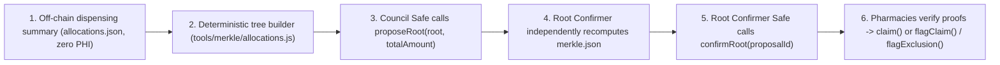

# Off-Chain Allocation Pipeline & Pharmacy Contest Path

**Status:** Operational & Auditor Reference (Unaudited Prototype)  
**Scope:** `tools/merkle/allocations.js`, `contracts/PBMRebateTreasury.sol`, `scripts/export-portability.js`, `scripts/verify-export.js`

---

## 1. End-to-End Allocation Pipeline



### Stage 1: Off-Chain Allocation Input (`allocations.json`)
- **Zero PHI / Raw Credentials Rule**: Allocation inputs must contain **only** Ethereum claimant addresses and integer token amounts in the payout token's smallest unit (e.g., `18` decimals for DAI, `6` decimals for USDC). Never include patient identifiers, prescription numbers, or raw NPI-to-wallet linkage tables in public root bundles.
- **Required Schema**:
  ```json
  {
    "entries": [
      {
        "pharmacy": "0x70997970C51812dc3A010C7d01b50e0d17dc79C8",
        "grossAmount": "12450000000000000000000",
        "eligibleCap": "12450000000000000000000"
      }
    ]
  }
  ```
- **Pre-Tree Validation**: Every `pharmacy` address must be unique and non-zero, `grossAmount > 0`, `eligibleCap >= grossAmount`, and `sum(grossAmount)` must not exceed `min(distributionPool, dailyVolumeCap, hardAbsoluteVolumeCap)`.

### Stage 2: Deterministic Merkle Tree Construction (`tools/merkle/allocations.js`)
Run locally or in deterministic CI:
```bash
npm run merkle:allocations -- --in allocations.json --out merkle.json
```
- **Double-Hashed Leaf Formula** (prevents second-preimage attacks and matches `PBMRebateTreasury.sol`):
  ```solidity
  bytes32 leaf = keccak256(
      bytes.concat(keccak256(abi.encodePacked(pharmacy, grossAmount, eligibleCap)))
  );
  ```
- **Tree Pairing**: Sibling pairs are sorted lexicographically (`min(a, b) || max(a, b)`) at each layer to match OpenZeppelin `MerkleProof.verify`.

### Stage 3: Dual-Safe Staging & Confirmation
1. **Proposal (`COUNCIL_ROLE`)**: Council Safe calls `proposeRoot(merkleRoot, totalAmount)` during an open epoch without an active root. Proposals expire if unconfirmed within the contract's proposal window.
2. **Independent Verification (`ROOT_CONFIRMER_ROLE`)**: Before signing `confirmRoot(proposalId)`, the separate Root Confirmer Safe recomputes `merkle.json` from the epoch's underlying dispensing/rebate summary and verifies `merkleRoot` and `totalAmount`.
3. **Escrow Lock**: `confirmRoot` moves `totalAmount` out of unallocated `distributionPool` into `epochEscrow[currentEpoch]` and increments `totalEscrowed`.

---

## 2. Pharmacy Verification & Contest Paths

Before submitting any transaction, a pharmacy (or its local CLI verifier) checks its allocation entry against `merkle.json` and the on-chain `epochMerkleRoot[epoch]`.

| Scenario | On-Chain Entrypoint | Escrow & Cap Accounting | Resolution / Timeout Path |
| :--- | :--- | :--- | :--- |
| **Allocation is accurate** | `claim(amount, eligibleCap, proof)` | Deducts `amount` from `epochEscrow[epoch]`; increments `epochRootClaimedTotal[epoch]` and `epochVolume`; sends `100% - patientClaimBP` to pharmacy and `patientClaimBP` (`10%` default) to `immutable` `patientFund`. | Immediate atomic settlement. |
| **Included in root, but amount/terms are contested** | `flagClaim(amount, eligibleCap, proof, reason, evidenceHash)` | Requires valid Merkle proof + non-zero `evidenceHash`. Moves `amount` from `epochEscrow[epoch]` into quarantined `flaggedAmount[epoch][msg.sender]` and `totalFlaggedNormal` so funds cannot be recalled while disputed. | `COUNCIL_ROLE` resolves via `resolveClaim(epoch, pharmacy, resolution, evidenceHash)` (`RELEASE_TO_PHARMACY`, `SEND_TO_PATIENT_FUND`, or `DISMISS`). If unresolved after `DISPUTE_TIMEOUT` (`30 days`), claimant can call `retractClaimDispute(epoch)`. |
| **Omitted from Merkle root entirely** | `flagExclusion(epoch, amount, evidenceHash)` | Does **not** touch `epochEscrow[epoch]` or `epochRootClaimedTotal[epoch]`, preventing root-escrow griefing by unverified callers. | Requires **dual-role sign-off**: `ROOT_CONFIRMER_ROLE` must call `approveExclusionClaim(epoch, pharmacy)` first, then `COUNCIL_ROLE` calls `resolveClaim(..., RELEASE_TO_PHARMACY, evidenceHash)` drawing strictly from `exclusionRemediationReserve` (subject to active volume caps), or `DISMISS`. |
| **Address placed under sanction** | `appealSanction(reason, evidenceHash)` | Callable by the sanctioned address with a non-zero `evidenceHash`; emits `SanctionAppealed` on-chain. | Procedural 14-day Council review window (`GOVERNANCE.md`); lifting sanction calls `updateSanction(account, false, reason)`. |

---

## 3. Portability Export & Post-Epoch Audit

Participants can export and verify epoch proofs at any time:
```bash
node scripts/export-portability.js --exporter <address> --from-block <start> --to-block <end>
npm run verify:export -- --file exports/<address>.json --rpc <rpc_url>
```
Offline verification checks JSON structure and Merkle inclusion math; passing `--rpc` additionally checks on-chain event and root provenance.
